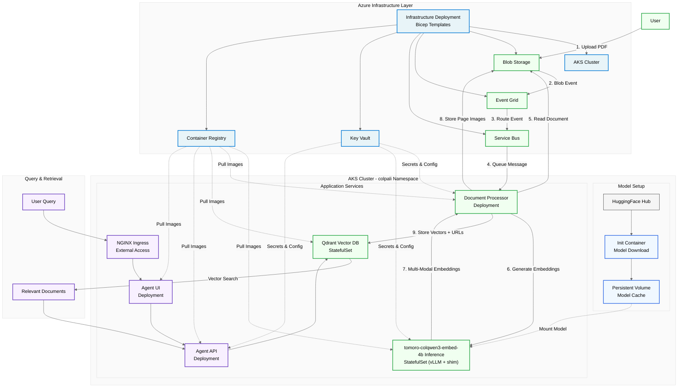

# Multi-Modal RAG with ColPali on Azure Kubernetes Service (AKS)

[](https://github.com/microsoft/multi-modal-rag-with-colpali/actions/workflows/ci.yml)

> [!TIP]
>
> **[PULSAR: Pooled Unified Late-Interaction Search and Retrieval for Enterprise Visual Document RAG](https://arxiv.org/abs/2608.28572)** describes a downstream production system built on this accelerator's vLLM serving and Helm/AKS deployment. Its production extensions and measured results do not describe an out-of-the-box deployment of this repository. See [Relationship to PULSAR](#relationship-to-pulsar).

> [!WARNING]
>
> This **accelerator** defaults to [TomoroAI's](https://huggingface.co/TomoroAI) [ColQwen3 model (`tomoro-colqwen3-embed-4b`)](https://huggingface.co/TomoroAI/tomoro-colqwen3-embed-4b), building on the foundational [ColPali approach and tooling](https://github.com/illuin-tech/colpali) from [Illuin Technology](https://www.illuin.tech/), including hierarchical token pooling. It is **not a production-ready solution**. Review and adjust the code before using it in your environments.

This repository provides a multi-modal RAG (Retrieval-Augmented Generation) solution that processes document pages as images. Each page produces hundreds of token-level embeddings rather than a single vector. Late interaction compares query tokens directly with these embeddings, helping retrieve content from text, charts, tables, and page layouts.

This repository uses **ColQwen3** by default; other compatible ColQwen2/ColQwen3 late-interaction embedding models can be substituted.

## Vision Language Models & ColPali

**Why vision models over traditional text extraction?**

Text extraction pipelines often need OCR, chunking, and separate handling for tables and images. Vision Language Models (VLMs) process whole pages as images, handling text, tables, charts, and diagrams together without OCR or text chunking.

### What is ColPali?

ColPali is a multi-modal document understanding model that processes documents as images rather than extracted text. Unlike traditional text-only approaches, ColPali generates embeddings that capture both textual content and visual layout information.


*ColPali Architecture - Image source: [illuin-tech/colpali](https://github.com/illuin-tech/colpali) repository*

**Key characteristics:**
- **Visual Processing**: Processes document pages as images, preserving layout and formatting
- **Page-Level Embeddings**: Generates vector representations for entire document pages
- **Multi-Modal**: Understands both text and visual elements like tables, charts, and document structure
- **No OCR Required**: Bypasses text extraction preprocessing steps

This implementation ships with **[`TomoroAI/tomoro-colqwen3-embed-4b`](https://huggingface.co/TomoroAI/tomoro-colqwen3-embed-4b)** — a 4B-parameter ColQwen3 model with 320-dimensional token embeddings. [vLLM](https://github.com/vllm-project/vllm) runs inference on the GPU; a CPU service handles image preparation and pooling. To use another compatible ColQwen2/ColQwen3 late-interaction model, change `colpaliInference.modelId` in the Helm values. See the **[Inference Service Guide](modules/colpali_inference/README.md)** for details.

ColPali was introduced in the paper ["ColPali: Efficient Document Retrieval with Vision Language Models"](https://arxiv.org/abs/2407.01449) by Manuel Faysse, Hugues Sibille, Tony Wu, et al. (2024).

## What's Included

This repository includes model serving, document indexing, and deployment scripts for Azure.

**Components:**
- Event-driven document processing pipeline (Blob Storage → Event Grid → Service Bus)
- ColQwen3 (`TomoroAI/tomoro-colqwen3-embed-4b`) inference service on AKS — vLLM GPU sidecar + CPU pooling shim, with model weights cached on a shared PVC
- Qdrant vector database for similarity search
- Complete infrastructure as code (Bicep templates)
- Docker images and Helm charts for all services
- Agent API and UI for querying

### Architecture Overview

#### Event-Driven Document Processing
1. **PDF Upload** → Users upload documents to Azure Blob Storage
2. **Event Trigger** → Storage generates blob events, routed by Event Grid to Service Bus
3. **Async Processing** → Document Processor consumes queue messages and reads documents
4. **Image Extraction** → Documents converted to high-resolution page images
5. **AI Inference** → `tomoro-colqwen3-embed-4b` (served via vLLM) generates multi-modal embeddings on AKS pods
6. **Image Storage** → Page images uploaded to Azure Blob Storage for retrieval
7. **Vector Storage** → Embeddings stored in Qdrant with metadata and image URLs

#### Query & Retrieval
8. **User Queries** → Submitted via NGINX Ingress to Qdrant vector database
9. **Semantic Search** → Vector similarity search returns relevant document sections with image URLs
10. **Image Retrieval** → Page images fetched from Azure Blob Storage using stored URLs
11. **RAG Integration** → AI Foundry models use retrieved pages to answer the query




For Azure resources and deployment details, see the **[Infrastructure Guide](modules/infra/README.md)**.

## Why Qdrant Vector Database + Azure Kubernetes Service?

### Why Qdrant Vector Database over AI Search for ColPali specific scenarios?
- **Multi-Vector Limits**: AI Search has a 100-vector limit per document, while Qdrant has no such restriction. ColPali-based models produce more than 100 embeddings per document.
- **Multi-Vector Operations**: Qdrant supports reranking and MAX_SIM operations that we cannot perform natively in AI Search. These let us compare query embeddings directly with document embeddings.

> [!NOTE]
>
> AI Search also supports [multi-modal RAG](https://learn.microsoft.com/en-us/azure/search/multimodal-search-overview). In our benchmarks, ColPali-based approaches gave better retrieval quality and higher indexing throughput at scale. Results vary, so benchmark your own use case.

### Why AKS over Container Apps?
- **Managed Disk Support**: Qdrant requires persistent managed disk storage (not NFS volumes) for optimal performance per Qdrant's recommendations. This is not possible with other container based setups on Azure at the time of experimentation.
- **Simpler Setup**: No need to setup multiple Azure Services to host the different services, everything can run inside the same AKS cluster.
- **Shared Compute Costs**: Multiple services (document processor + ColQwen3 inference) share the same node pool.

## Project Structure

```
├── modules/
│   ├── agent/          # RAG agent application
│   ├── colpali_inference/   # tomoro-colqwen3-embed-4b inference service (vLLM sidecar + CPU shim)
│   ├── document_processor/  # FastAPI document processing service
│   ├── helm/           # Helm charts for AKS deployment
│   └── infra/          # Bicep infrastructure templates
└── scripts/            # Deployment automation
```

## Scalability Optimizations

Two techniques make these token-level embeddings practical at scale:

**[Hierarchical token pooling](https://github.com/illuin-tech/colpali?tab=readme-ov-file#token-pooling)** (from the ColPali team) reduces the number of vectors by approximately the pooling factor (3 by default), not their dimensionality. Retrieval quality should be evaluated for the chosen model and corpus.

**Mean row and column pooling** (from [Qdrant's PDF retrieval tutorial](https://qdrant.tech/documentation/advanced-tutorials/pdf-retrieval-at-scale/)) compresses embeddings further for fast initial retrieval.

**Two-stage retrieval:**
1. L1 uses row/column pooled embeddings for fast candidate selection
2. L2 reranks with hierarchical pooled embeddings for accuracy

**Chosen approach:** We use row/column mean pooling for L1 and hierarchical pooling for L2 with binary-quantized prefetch (`mean_pooling_with_hierarchical_quantized_prefetch_only`). L2 uses unquantized hierarchical-pooled vectors for MaxSim scoring of the shortlist; "exact" scoring at this stage does not make the approximate candidate selection or pooled representation lossless.

### Relationship to PULSAR

[Section 3.2 of PULSAR](https://arxiv.org/html/2608.28572#S3.SS2) credits this accelerator for vLLM serving and Helm/AKS deployment. The paper combines these foundations with production ingestion, retrieval tuning, and evaluation. It supports the two-stage design, but it is not a reproduction guide or a production-readiness certification for this repository.

The paper reports the following results under different measurement conditions:

| Result | Scope and qualification |
|--------|-------------------------|
| **15.1x lower median vector-search latency** | On ViDoRe V3, quantized mean-pooled prefetch plus hierarchical-pooled reranking took 49.9 ms versus 752.7 ms unpooled, with absolute NDCG@10 and Recall@10 losses of 0.0088 and 0.0074. These are single-stream search measurements, not end-to-end answer latency ([Section 5.2](https://arxiv.org/html/2608.28572#S5.SS2)). |
| **156 ms production median vector-search latency** | Measured over a seven-day window on PULSAR's production infrastructure and corpus; not an accelerator service-level guarantee ([Section 5.3](https://arxiv.org/html/2608.28572#S5.SS3)). |
| **Approximately 20x lower ingestion cost per page** | A call-count estimate priced at list rates against the replaced OCR-plus-verbalisation pipeline, not metered cloud spend. It excludes standing serving costs and answer-time inference ([Section 5.4](https://arxiv.org/html/2608.28572#S5.SS4)). |
| **More than double answer-fact recall at production top-k** | An evaluation of 75 expert-authored questions across seven deals against one OCR-plus-verbalisation baseline, not evidence of superiority over every text or vision-first system ([Section 5.7](https://arxiv.org/html/2608.28572#S5.SS7)). |

PULSAR also separates **150-DPI embedding images from 500-DPI answer images**. Its embedding-DPI study raised the visual-token cap to avoid resolution clipping; changing render DPI alone does not reproduce that setup. The zero page-legibility errors at 500 DPI were observed on 516 questions from just two decks, with the source page supplied directly to the answering model, so they do not establish error-free end-to-end RAG ([Sections 5.1](https://arxiv.org/html/2608.28572#S5.SS1) and [5.6](https://arxiv.org/html/2608.28572#S5.SS6)).

#### Pending version-two indexer port

The PULSAR-aligned indexer port is being developed separately and is **not included in this documentation change**. Its implementation includes the following changes; they are not yet defaults or guarantees of this branch:

| Area | Pending implementation and differences from PULSAR |
|------|----------------------------------------------------|
| Image preparation | 150-DPI embedding and 500-DPI storage defaults. Render once at storage resolution, crop, and downsample a separate embedding copy rather than render the PDF twice. Token-limit recovery reduces only the embedding image, not the stored answer image. |
| Resolution limits | A 4,194,304-pixel preprocessing cap (4,096 merged visual tokens for this model) and a 3,072-token sequence budget, including prompt tokens. The visual ceiling does not mean every image fits that sequence budget. The paper's 65,536 visual-token DPI-ablation cap is not the production default. |
| Incremental ingestion | Bounded page rendering, file/page hashes, a processing fingerprint, durable-page resume, and refreshed extracted text for OCR-only changes. Completion requires full page coverage, successful image uploads and Qdrant writes, a source ETag check, and orphan cleanup. |
| Retrieval and storage | Top 5 pages, at least 200 candidates per mean-pooled vector, HNSW ef 64, binary prefetch rescoring with 2x oversampling, and hierarchical pooling factor 3. Full-precision pooled vectors are stored on disk alongside binary mean-vector copies in RAM, not replaced by a quantized-only representation. |
| Remaining production gaps | One document queue, not PULSAR's preemptive document-priority lanes. Completion checks govern success and resume state, not retrieval visibility: partially processed documents can have searchable pages. Qdrant's `indexed_only` option concerns optimized segments, not document completeness or atomic publication. |

The port also introduces a **breaking index contract**: 320-dimensional vectors, renamed mean-vector fields, nested payloads, new page IDs, and new image paths. Existing indexes need reindexing into a fresh collection and a coordinated writer/reader switch; deploying updated services alone does not migrate historical data. Keep old collections and images until the replacement is verified.

Runtime upgrades are tracked separately from the paper-aligned settings. A newer Python, Transformers, or vLLM runtime is not a reproduction of the paper's software stack. Local/component checks and runtime smoke checks do not establish the paper's retrieval quality, throughput, cost, or end-to-end answer results.

See the [Document Processor Guide](modules/document_processor/README.md) for the checked-out version's ingestion contract, the [Inference Service Guide](modules/colpali_inference/README.md) for preprocessing constraints, and the [Agent Guide](modules/agent/README.md) for search settings. The port updates these guides alongside its implementation. Benchmark retrieval quality, image legibility, memory, and latency on your own workload before production rollout.

## Quick Start

Follow the **[first-run guide](scripts/README.md)** to deploy, upload a PDF, ask a
question, and clean up the resources. It includes prerequisites and common failures.

Deployment requires an Azure subscription, PowerShell 7, Azure CLI, kubectl, Helm,
and Docker. Local Python development uses Python 3.12 and uv.

## Contributing

We welcome contributions! Please see our [Contributing Guide](CONTRIBUTING.md) for details on:

- Setting up pre-commit hooks for automatic code quality checks
- Code standards and linting requirements
- Submitting pull requests

Quick start:
1. Fork the repository
2. Install pre-commit hooks: `pip install pre-commit && pre-commit install`
3. Create a feature branch
4. Make your changes (hooks will run automatically on commit)
5. Submit a pull request

## License

MIT License - see [LICENSE](LICENSE) for details.
