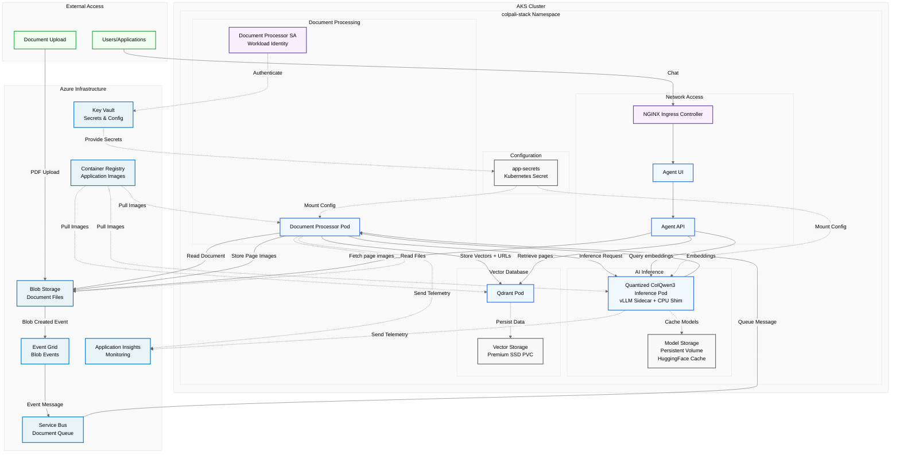

# ColPali/ColQwen Stack Helm Chart

Helm chart for deploying the ColPali/ColQwen multi-modal RAG stack.

## Components

This chart deploys the following components:

### Core Services
- **Quantized ColQwen3 Inference** (`TomoroAI/tomoro-ai-colqwen3-embed-4b-awq`) - Late-interaction embedding service: GPU vLLM sidecar (`/pooling` endpoint, no CPU weight offload) + CPU FastAPI shim for tokenization and pooling (StatefulSet). See the [model and GPU memory guidance](../../colpali_inference/README.md#quantized-checkpoint-and-gpu-memory) for tuning.
- **Document Processor** - Processes documents, creates embeddings, stores vectors in Qdrant and images in Blob Storage
- **Agent API** - REST API for querying documents using RAG
- **Agent UI** - Chainlit-based chat interface for interacting with the RAG system

### Infrastructure
- **Qdrant** - Vector database for embeddings storage (via Helm dependency)
- **NGINX Ingress Controllers** - Agent UI ingress; optional controllers for inference and Qdrant
- **Stakater Reloader** - Automatically restarts pods when secrets change (via Helm dependency)

### Configuration & Security
- **App Secrets** - CSI SecretProviderClass for syncing Azure Key Vault secrets to Kubernetes
- **Service Account** - Workload Identity-enabled service account for Azure authentication

The [infrastructure bootstrap](../../infra/README.md#kubernetes-bootstrap-resources)
creates the namespace and installs the NVIDIA device plugin and DCGM exporter.

## Spot Instance Support

The `colpali-stack` namespace is configured with a `scheduler.alpha.kubernetes.io/defaultTolerations` annotation that automatically injects the spot instance toleration into all pods. This allows workloads to be scheduled on cost-effective spot instance node pools without requiring individual pod configuration.

```yaml
annotations:
  scheduler.alpha.kubernetes.io/defaultTolerations: '[{"Key": "kubernetes.azure.com/scalesetpriority", "Operator": "Equal", "Value": "spot", "Effect": "NoSchedule"}]'
```

## Prerequisites

1. Run infrastructure deployment: `.\scripts\deploy_infra.ps1`
2. Have kubectl and helm installed

### Node pools

The infrastructure uses `systempool` for cluster services, `cpupool` for CPU
workloads, and `gpupool` for GPU workloads. The chart's CPU selectors target
`cpupool`; `colpaliInference.nodePool` defaults to `gpupool`.

## Deploy Everything

```powershell
.\scripts\apply_helm.ps1
```

This automatically:
1. Restores locked Helm dependencies (`helm dependency build`)
2. Deploys the application components
3. Sets up Qdrant with Premium SSD storage
4. Exposes Agent UI through ingress; inference and Qdrant remain internal by default

## Access Qdrant Dashboard

Forward the internal Qdrant service locally:
```powershell
kubectl port-forward -n colpali-stack service/colpali-stack-qdrant 6333:6333
```

Open `http://localhost:6333/dashboard` and use the configured Qdrant API key.

## Configuration

The chart uses Helm dependencies defined in `Chart.yaml`:
- `qdrant` from https://qdrant.github.io/qdrant-helm
- `ingress-nginx` from https://kubernetes.github.io/ingress-nginx

Values are passed from the deployment script via `--set` parameters.

### Indexing and inference tuning

The chart's [values.yaml](values.yaml) is the source of deployment defaults.
Application environment variables are set on the relevant containers from these
values; setting a variable in your local shell or adding it to the deployment
script's `.env` does not automatically change a running pod.

| Chart value | Application environment | Default |
|---|---|---|
| `qdrantCollectionName` | `QDRANT_COLLECTION_NAME` in processor and agent | `colpali-documents` |
| `documentProcessor.replicaCount` | Kubernetes replica count | 2 |
| `documentProcessor.processing.documentMaxConcurrent` | `DOCUMENT_MAX_CONCURRENT` | 3 per process |
| `documentProcessor.processing.colpaliMaxConcurrent` | `COLPALI_MAX_CONCURRENT` | 5 per process |
| `documentProcessor.processing.colpaliBatchSize` | `COLPALI_BATCH_SIZE` | 1 |
| `documentProcessor.processing.renderBufferMaxPages` | `RENDER_BUFFER_MAX_PAGES` | 4 per document |
| `documentProcessor.processing.storageDpi` | `COLPALI_STORAGE_DPI` | 500 |
| `documentProcessor.processing.embeddingDpi` | `COLPALI_EMBEDDING_DPI` | 150 |
| `documentProcessor.processing.cropWhitespace` | `COLPALI_CROP_WHITESPACE` | `true` |
| `documentProcessor.processing.maxRenderPixels` | `PDF_MAX_RENDER_PIXELS` | 75,000,000 |
| `documentProcessor.processing.indexingRevision` | `INDEXING_REVISION` | `"1"` |
| `colpaliInference.modelId` | `MODEL_ID` in downloader, shim, vLLM, and processor | Quantized ColQwen3 |
| `colpaliInference.maxImagePixels` | `COLPALI_MAX_IMAGE_PIXELS` in shim, vLLM, and processor | 4,194,304 |
| `colpaliInference.vllm.maxModelLen` | `VLLM_MAX_MODEL_LEN` | `"3072"` |
| `colpaliInference.vllm.gpuMemoryUtilization` | `VLLM_GPU_MEMORY_UTILIZATION` | `"0.75"` |
| `colpaliInference.vllm.cpuOffloadGb` | `VLLM_CPU_OFFLOAD_GB` | `"0"` |

The default two processor replicas allow up to ten one-page inference requests.
These are per-process limits, not a cluster-wide semaphore. Multi-image shim
requests fan out into separate vLLM pooling calls, so a larger batch can increase
GPU work even when the request concurrency is unchanged. The render queue bounds
queued page images, not total memory across documents/replicas. GPU utilization
is a model-memory budget, not a throughput percentage: preserve headroom for
the unquantized vision encoder and validate representative page sizes.

For a deployed release, save an override file outside version
control, for example `tuning.yaml`:

```yaml
documentProcessor:
  replicaCount: 2
  processing:
    documentMaxConcurrent: 3
    colpaliMaxConcurrent: 5
    colpaliBatchSize: 1
    renderBufferMaxPages: 4
colpaliInference:
  maxImagePixels: 4194304
  vllm:
    maxModelLen: "3072"
    gpuMemoryUtilization: "0.75"
    cpuOffloadGb: "0"
```

Apply it to the intended release without replacing its saved connection settings
or image tags:

```powershell
helm upgrade colpali-stack .\modules\helm\colpali-stack `
    --namespace colpali-stack --kubeconfig "C:\path\test.kubeconfig" `
    --reuse-values --values "C:\path\tuning.yaml" --wait --timeout 30m
```

Reuse the override file on subsequent upgrades; `apply_helm.ps1` does not accept it automatically.
Rendering/model changes can invalidate indexing fingerprints; changing settings
does not enqueue existing documents. Reindex explicitly and compare retrieval
quality as well as throughput, failures, GPU memory, and mixed-query latency.

The Qdrant chart dependency is pinned to **1.20.0**. Retrieval defaults and their
limits are documented in the [agent guide](../../agent/README.md#implemented-retrieval-defaults);
not every search parameter is an environment-variable override.

## Architecture Overview

### Pod Architecture


**Legend:**
- **Solid arrows**: Data/request flow
- **Dashed arrows**: Configuration, authentication, storage, and monitoring relationships
