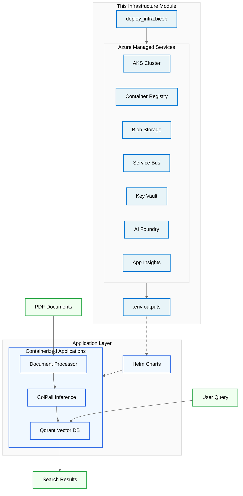
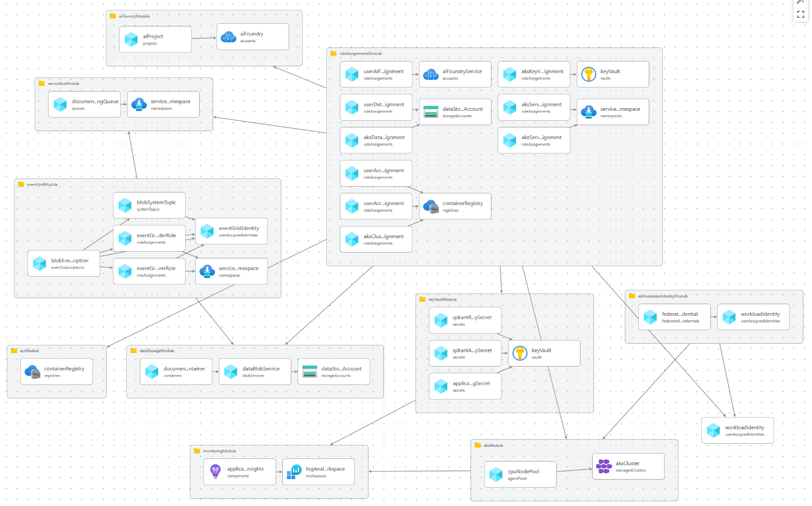

# Infrastructure

Azure infrastructure for the ColPali multi-modal RAG solution. This module provisions all managed Azure services needed to run the containerized workloads on Kubernetes.

This creates **only** the Azure services. The ColPali applications (model inference, document processing, vector database) are deployed separately to AKS via Helm charts in `/modules`.

> [!IMPORTANT]
>
> - The GPU node pool is configured to run on Azure Spot VMs for cost-effective testing. For production environments, provision a regular (non-spot) GPU node pool to avoid eviction-related downtime.
> - The vLLM 0.32.0 image uses the CUDA 12.9 variant to retain AKS-managed A10 drivers. Verify driver compatibility and real GPU inference before application deployment. Container builds and Helm upgrades do not upgrade host drivers; see the [runtime upgrade requirements](../colpali_inference/README.md#runtime-upgrade-requirements).



Below is the topology of the Azure resources deployed by this module:



## Azure Infrastructure Components

Azure managed services that support the Kubernetes workloads:

| Component | Resource Type | Purpose |
|-----------|---------------|---------------|
| Container Registry (`acr${baseName}`) | Azure Container Registry | Stores container images for document processing and ColPali inference. |
| AI Foundry Workspace (`aif-${baseName}`) | Azure AI Foundry | LLM services and AI platform for the RAG solution. |
| AKS Cluster (`aks-${baseName}`) | Azure Kubernetes Service | Kubernetes cluster hosting all application services. |
| Data Storage (`stdata${baseName}`) | Azure Storage Account | Blob storage for documents, page images, and application data. |
| Service Bus (`sbns-${baseName}`) | Azure Service Bus | Message queuing for asynchronous document processing. |
| Key Vault (`kv-${baseName}`) | Azure Key Vault | Secure storage for secrets and connection strings. |
| Event Grid (`eg-${baseName}`) | Azure Event Grid | Event routing for document upload notifications. |
| Monitoring (`appi-${baseName}`) | Application Insights | Application monitoring, logging, and telemetry. |
| Role Assignments | Azure RBAC | Managed identity access for AKS workloads to storage, Service Bus, and container registry. |

## Kubernetes Application Components

The following services are deployed to the AKS cluster via Helm charts (see `/modules` for implementation):

| Component | Type | Purpose |
|-----------|------|---------|
| ColPali Model Download | Init Container | Downloads ColPali models from HuggingFace and persists to Persistent Volume Claims before inference pods start. |
| ColPali Inference | Deployment | StatefulSet running ColPali inference pods with PVCs for model storage, serving multi-modal embedding API. |
| Document Processor | Deployment | FastAPI application handling PDF ingestion, image extraction, blob storage upload, and vector indexing workflows. |
| Qdrant Vector Database | StatefulSet | Stores document embeddings, metadata, and blob storage URLs for similarity search. |

## Infrastructure Structure

```
src/main.bicep                # Orchestrates modules & outputs
src/main.bicepparam           # Parameters (override defaults)
src/modules/                  # Azure infrastructure modules
├── aiFoundry.bicep          # AI Foundry workspace for LLM services
├── aks.bicep                # AKS cluster for Kubernetes workloads
├── aksFederatedIdentity.bicep # Workload identity for AKS pod authentication
├── containerRegistry.bicep   # Container registry for application images
├── dataStorage.bicep        # Blob storage for documents and data
├── eventGrid.bicep          # Event Grid for workflow orchestration
├── keyVault.bicep           # Key Vault for secrets management
├── monitoring.bicep         # Application Insights for observability
├── roleAssignments.bicep    # RBAC for cross-service access
└── serviceBus.bicep         # Service Bus for reliable message queuing
src/k8s/                      # Kubernetes cluster bootstrap manifests
├── namespace-spot-tolerations.yaml  # Namespaces with spot instance tolerations
├── gpu-resources-namespace.yaml     # Namespace for GPU infrastructure
├── nvidia-device-plugin.yaml        # NVIDIA device plugin for GPU scheduling
└── dcgm-exporter.yaml               # GPU metrics exporter for Prometheus
```

## Azure Verified Modules

The local Bicep files wrap version-pinned [Azure Verified Modules (AVM)](https://azure.github.io/Azure-Verified-Modules/) from the public Bicep registry. `main.bicep` retains its five input parameters and all 30 output names and types, keeping the deployment script's `.env` mapping and its consumers compatible.

| Resource | AVM reference (`br/public:avm/` prefix) |
|----------|---------------------------------------|
| Container Registry | `res/container-registry/registry:0.13.1` |
| Storage account and blob containers | `res/storage/storage-account:0.33.1` |
| Service Bus namespace and queue | `res/service-bus/namespace:0.17.1` |
| Key Vault and secrets | `res/key-vault/vault:0.14.2` |
| Log Analytics | `res/operational-insights/workspace:0.16.1` |
| Application Insights | `res/insights/component:0.8.0` |
| User-assigned identities and federation | `res/managed-identity/user-assigned-identity:0.6.0` |
| Event Grid system topic and subscription | `res/event-grid/system-topic:0.7.0` |
| AKS, node pools, and diagnostics | `res/container-service/managed-cluster:0.14.0` |
| Foundry account, project, and model deployment | `ptn/ai-ml/ai-foundry:0.7.0` |
| Prometheus data collection rule | `res/insights/data-collection-rule:0.11.0` |
| Resource-scoped role assignments | `ptn/authorization/resource-role-assignment:0.1.2` |

The Azure Monitor workspace (`Microsoft.Monitor/accounts`) and AKS Prometheus data collection rule association remain native Bicep resources: no suitable published Bicep AVMs were found for these in the official catalog and registry. The Foundry pattern covers the account, project, and model without creating its optional associated services or capability hosts. Existing-resource declarations provide references for parent/scope and runtime outputs; they do not deploy duplicate resources.

### Compatibility and differences

Resource names (except the explicitly standardized node pool names below), model version/capacity, queue behavior, blob containers, Event Grid filtering/retries, RBAC scopes and assignment GUIDs, and the AKS pool sizes/autoscaling/Spot configuration are preserved. AVM telemetry is disabled. Explicit overrides avoid AVM defaults that would otherwise introduce paid AKS tiers, availability zones, private networking, Azure Policy, storage soft deletion/infrastructure encryption, ACR image retention, Key Vault purge protection, or longer log retention. The workload identity and its federated credential now deploy together after AKS supplies its OIDC issuer.

Networking compatibility is measured against the original Bicep, not policy-modified live settings. Storage and ACR retain explicit public network access; Storage and Key Vault retain `Allow`/`AzureServices` ACLs. Key Vault's public-access property remains unspecified, as before. No private endpoint inputs are supplied, their AVM deployment loops have zero instances, and AKS private-cluster settings remain unspecified. Foundry's separate outbound-access restriction below is a known exception to network parity. Azure Policy may still modify or deny requests independently of these template settings.

The generated ARM template is **not identical** to the previous template. Review these differences before updating an existing environment:

| Area | Difference |
|------|------------|
| Deployment structure | AVM adds nested deployments and uses its own resource API versions. Resource IDs are preserved except for renamed node pools, but deployment history and what-if output will differ. |
| AKS node pool names | Pool names consistently use the `pool` suffix: `systempool`, `cpupool`, and `gpupool`, replacing `system` and `gpuinference`. This is an intentional naming change, not an AVM requirement. AKS pools cannot be renamed in place: create replacement pools, verify ready system capacity, move workloads/update Helm selectors, then remove the old pools. Incremental Bicep deployment alone does not clean up the old pools. |
| Foundry pattern | Account/project names and UK South placement are explicit, as are the GPT-4.1 version, GlobalStandard SKU, and capacity of 100. The pattern sets the project's display name and description (both set to the existing project name here), whereas the old template omitted them. It also uses an underlying account module whose `restrictOutboundNetworkAccess` defaults to `true` and is not configurable through the pattern; the original template left this unset. **Review workloads that require outbound access.** Public inbound access remains enabled, local authentication remains disabled, and no optional Storage, Search, Cosmos DB, Key Vault, connections, or capability hosts are added. |
| AKS secret rotation | AVM exposes rotation enablement but not `rotationPollInterval`. Rotation remains enabled and relies on Azure's [documented two-minute default](https://learn.microsoft.com/azure/aks/csi-secrets-store-configuration-options), rather than explicitly sending `2m`. |
| AKS defaults | The default `MC_<resource-group>_<cluster>_<location>` node resource group name, Free tier, local accounts, disk/file CSI drivers, snapshot controller, and non-zonal pools are explicit. AVM also sends network/load-balancer and disabled-addon defaults previously left to Azure. An existing cluster customized outside this template may show changes. |
| AKS Kubernetes version | The wrapper's optional `kubernetesVersion` now defaults to `null`, rather than pinning `1.34.0`. AVM forwards a supplied cluster version to node pools that omit their own version, which otherwise requests a downgrade after automatic patch upgrades. Leaving it unspecified avoids that stale patch request; new clusters use Azure's default version. The `patch` auto-upgrade channel remains enabled. Supply a version to the wrapper only for an intentional, supported upgrade. |
| Monitoring | The legacy Log Analytics `features.legacy: 0` field is not exposed by AVM. Application Insights explicitly uses the service defaults of 90-day retention and IP masking, instead of AVM's 365 days and disabled masking. Log Analytics retains 30-day retention and a 2-GB daily cap by default. |
| Storage and Service Bus | AVM makes additional settings explicit, including disabled cross-tenant replication/local users/blob versioning and Service Bus TLS 1.2. These may differ from older or manually customized resources even though this application's blob/queue behavior is unchanged. |
| Deployment permissions | Storage, Log Analytics, and Service Bus AVMs evaluate secure key outputs internally, even though this template does not export them. The deployment identity needs their `listKeys` permissions. The Service Bus module expects the service-created `RootManageSharedAccessKey` rule to exist; local/SAS authentication remains disabled. |

The existing `newGuid()` defaults for Qdrant secrets are unchanged: redeploying without supplying those secret parameters still generates new secret values. Runtime-generated endpoints and identity IDs are read from the same named resources, not fabricated by the wrappers. A read-only `aiFoundryOutputs.bicep` module depends on the Foundry pattern's outputs so first-time deployments do not query resources before creation completes. It creates no Azure resources.

### Validation

Use Azure CLI with a recent Bicep CLI and access to `mcr.microsoft.com` to restore the pinned modules, plus PowerShell (`pwsh`) for the deployment-script tests. The offline regression checks compile the template and cover the public output contract, environment variable names consumed by the deployment/build scripts, private endpoint/private-cluster defaults, key resource settings, AVM coverage, and Event Grid/RBAC dependencies. Mocked CLI tests also verify tenant-specific user ID resolution, consistent subscription selection, and deployment/bootstrap error handling without contacting Azure:

```powershell
python -m unittest discover -s .\modules\infra\tests -v
```

Offline checks cannot prove that Azure will make no changes to a particular deployed environment. Before deploying, select the intended subscription and run what-if against the existing resource group with the same parameters used for that environment:

```powershell
az deployment group what-if --resource-group $ResourceGroup `
    --parameters .\modules\infra\src\main.bicepparam userObjectId=$UserObjectId
```

## Kubernetes Bootstrap Resources

The `deploy_infra` script applies the `k8s/` manifests after creating the AKS cluster. These resources enable GPU scheduling and monitoring and must exist before deploying the application Helm charts.

| Resource | File | Purpose |
|----------|------|---------|
| `colpali-stack` namespace | `namespace-spot-tolerations.yaml` | Application namespace with spot instance tolerations |
| `gpu-resources` namespace | `gpu-resources-namespace.yaml` | Namespace for GPU infrastructure components |
| NVIDIA Device Plugin | `nvidia-device-plugin.yaml` | DaemonSet enabling `nvidia.com/gpu` resource scheduling on GPU nodes |
| DCGM Exporter | `dcgm-exporter.yaml` | GPU metrics (utilization, memory, temperature) for Prometheus monitoring |

The DCGM ServiceMonitor uses `azmonitoring.coreos.com/v1`, provided by the AKS
managed Prometheus add-on enabled in the Bicep template. It does not require a
separate Prometheus Operator installation.

> **Note**: These resources are deployed once per cluster, not with each application release.

## Naming Conventions

Azure resource names are centrally managed in `main.bicep` and passed to modules for consistency:

- Container Registry: `acr${baseName}` (hyphens stripped)
- AI Foundry Workspace: `aif-${baseName}`
- AKS Cluster: `aks-${baseName}`
- Data Storage: `stdata${baseName}` (trimmed to Azure length rules)
- Service Bus Namespace: `sbns-${baseName}`
- Event Grid: `eg-${baseName}`
- Key Vault: `kv-${baseName}`
- App Insights: `appi-${baseName}`

## Architecture Overview

The solution separates Azure infrastructure provisioning from Kubernetes application deployment:

**Azure Infrastructure** (this directory):
- Managed Kubernetes cluster (AKS) for container orchestration
- Container registry for storing application images
- Data services (Storage, Service Bus, Event Grid) for document processing workflows
- Identity and security (Key Vault, RBAC, Workload Identity) for secure access
- Monitoring and observability (Application Insights) for operational visibility

**Kubernetes Applications** (deployed via `/modules`):
- Auto-scaling based on HTTP requests and CPU utilization via Horizontal Pod Autoscaler
- Helm-based deployment of document processor, ColPali inference, and Qdrant vector database
- Workload identity integration for secure access to Azure services without storing credentials
- Persistent Volume Claims (PVCs) for model storage and data persistence

## How to Deploy

This infrastructure module provisions only the Azure foundation services. Application deployment is handled separately.

1. **Azure Infrastructure**: `deploy_infra.*` creates all Azure managed services (AKS cluster + supporting services)
2. **Kubernetes Applications**: Deploy services to AKS via the `/modules` directory (separate from this infrastructure)
   - ColPali model inference service
   - Document processor service
   - Qdrant vector database
   - Supporting services and configurations

## Outputs

Key outputs for Kubernetes application deployment and integration:

- `acrLoginServer`, `acrName` - Container registry for application images
- `aiFoundryName`, `aiFoundryEndpoint`, `aiFoundryProjectEndpoint`, `aiFoundryOpenAiEndpoint` - Foundry service and API endpoints
- `aksClusterName`, `workloadIdentityClientId`, `aksKubeletIdentityClientId` - AKS cluster and identities
- `dataStorageAccountName`, `dataStorageContainerName` - Blob storage for documents and application data
- `serviceBusNamespaceName`, `serviceBusQueueName` - Message queuing for document processing workflows
- `keyVaultName`, `keyVaultUri` - Secure storage for application secrets and certificates
- `eventGridSystemTopicId`, `eventGridEventSubscriptionId` - Event routing for workflow orchestration
- All configuration exported to `.env` for Kubernetes deployment scripts
