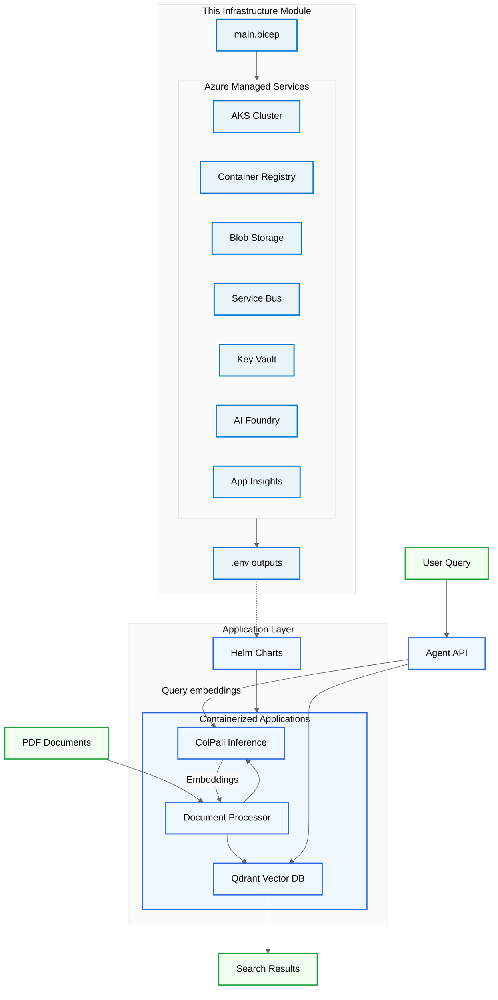

# Infrastructure

Azure infrastructure for the ColPali multi-modal RAG solution. This module provisions all managed Azure services needed to run the containerized workloads on Kubernetes.

This creates **only** the Azure services. The ColPali applications (model inference, document processing, vector database) are deployed separately to AKS via Helm charts in `/modules`.

> [!IMPORTANT]
>
> - The GPU node pool is configured to run on Azure Spot VMs for cost-effective testing. For production environments, provision a regular (non-spot) GPU node pool to avoid eviction-related downtime.
> - The vLLM 0.32.0 image uses the CUDA 12.9 variant to retain AKS-managed A10 drivers. Verify driver compatibility and real GPU inference before application deployment. Container builds and Helm upgrades do not upgrade host drivers; see the [runtime requirements](../colpali_inference/README.md#runtime-and-deployment).



Below is the topology of the Azure resources deployed by this module:


## Azure Infrastructure Components

Azure managed services that support the Kubernetes workloads:

| Component | Resource Type | Purpose |
|-----------|---------------|---------------|
| Container Registry (`acr${baseName}`) | Azure Container Registry | Stores container images for document processing and ColPali inference. |
| AI Foundry Workspace (`aif-${baseName}`) | Azure AI Foundry | LLM services and AI platform for the RAG solution. |
| AKS Cluster (`aks-${baseName}`) | Azure Kubernetes Service | Kubernetes cluster hosting all application services. |
| Data Storage (`stdata${baseName}`) | Azure Storage Account | Blob storage for documents, page images, and application data. |
| Service Bus (`sbns-${baseName}`) | Azure Service Bus | Message queuing for asynchronous document processing. |
| Key Vault (`kv-${baseName}`) | Azure Key Vault | Secure storage for secrets and connection strings. |
| Event Grid (`eg-${baseName}`) | Azure Event Grid | Event routing for document upload notifications. |
| Monitoring (`appi-${baseName}`) | Application Insights | Application monitoring, logging, and telemetry. |
| Role Assignments | Azure RBAC | Managed identity access for AKS workloads to storage, Service Bus, and container registry. |

## Kubernetes Application Components

The following services are deployed to the AKS cluster via Helm charts (see `/modules` for implementation):

| Component | Type | Purpose |
|-----------|------|---------|
| ColPali Model Download | Init Container | Downloads ColPali models from HuggingFace and persists to Persistent Volume Claims before inference pods start. |
| ColQwen3 Inference | StatefulSet | Quantized model serving through a GPU vLLM sidecar and CPU pooling shim, with a PVC for model storage. |
| Document Processor | Deployment | Service Bus consumer handling incremental PDF/image ingestion, bounded rendering, page-image storage, and durable vector indexing. |
| Qdrant Vector Database | StatefulSet | Stores document embeddings, metadata, and blob storage URLs for similarity search. |

## Infrastructure Structure

```
src/main.bicep                # Orchestrates modules & outputs
src/main.bicepparam           # Parameters (override defaults)
src/modules/                  # Azure infrastructure modules
├── aiFoundry.bicep          # AI Foundry workspace for LLM services
├── aks.bicep                # AKS cluster for Kubernetes workloads
├── aksFederatedIdentity.bicep # Workload identity for AKS pod authentication
├── containerRegistry.bicep   # Container registry for application images
├── dataStorage.bicep        # Blob storage for documents and data
├── eventGrid.bicep          # Event Grid for workflow orchestration
├── keyVault.bicep           # Key Vault for secrets management
├── monitoring.bicep         # Application Insights for observability
├── roleAssignments.bicep    # RBAC for cross-service access
└── serviceBus.bicep         # Service Bus for reliable message queuing
src/k8s/                      # Kubernetes cluster bootstrap manifests
├── namespace-spot-tolerations.yaml  # Namespaces with spot instance tolerations
├── gpu-resources-namespace.yaml     # Namespace for GPU infrastructure
├── nvidia-device-plugin.yaml        # NVIDIA device plugin for GPU scheduling
└── dcgm-exporter.yaml               # GPU metrics exporter for Prometheus
```

## Azure Verified Modules

The local Bicep files wrap version-pinned [Azure Verified Modules (AVM)](https://azure.github.io/Azure-Verified-Modules/) from the public Bicep registry. The deployment script maps `main.bicep` outputs to `.env` for application deployment.

| Resource | AVM reference (`br/public:avm/` prefix) |
|----------|---------------------------------------|
| Container Registry | `res/container-registry/registry:0.13.1` |
| Storage account and blob containers | `res/storage/storage-account:0.33.1` |
| Service Bus namespace and queue | `res/service-bus/namespace:0.17.1` |
| Key Vault and secrets | `res/key-vault/vault:0.14.2` |
| Log Analytics | `res/operational-insights/workspace:0.16.1` |
| Application Insights | `res/insights/component:0.8.0` |
| User-assigned identities and federation | `res/managed-identity/user-assigned-identity:0.6.0` |
| Event Grid system topic and subscription | `res/event-grid/system-topic:0.7.0` |
| AKS, node pools, and diagnostics | `res/container-service/managed-cluster:0.14.0` |
| Foundry account, project, and model deployment | `ptn/ai-ml/ai-foundry:0.7.0` |
| Prometheus data collection rule | `res/insights/data-collection-rule:0.11.0` |
| Resource-scoped role assignments | `ptn/authorization/resource-role-assignment:0.1.2` |

The Azure Monitor workspace (`Microsoft.Monitor/accounts`) and AKS Prometheus data collection rule association use native Bicep resources. The Foundry pattern covers the account, project, and model without creating optional associated services or capability hosts. Existing-resource declarations supply parent/scope references and runtime outputs.

### Deployment settings

AVM telemetry is disabled. Workload identity federation is configured after AKS supplies its OIDC issuer.

| Area | Configuration |
|------|------------|
| AKS pools | `systempool`, `cpupool`, and `gpupool`; Free tier, non-zonal pools, disk/file CSI drivers, and snapshot controller. |
| Kubernetes version | `kubernetesVersion` defaults to `null`, using Azure's default for new clusters. The `patch` auto-upgrade channel is enabled. |
| Secret rotation | Enabled with Azure's [two-minute default](https://learn.microsoft.com/azure/aks/csi-secrets-store-configuration-options). |
| Foundry | GPT-4.1 GlobalStandard, capacity 100, in UK South. Public inbound access is enabled, local authentication is disabled, and outbound network access is restricted. |
| Networking | Storage and ACR enable public network access. Storage and Key Vault use `Allow`/`AzureServices` ACLs. Key Vault's public-access property and AKS private-cluster settings are unspecified; no private endpoints are provisioned. Azure Policy can modify or deny these settings. |
| Monitoring | Application Insights: 90-day retention and IP masking. Log Analytics: 30-day retention and a 2-GB daily cap. |
| Storage and Service Bus | Cross-tenant replication, storage local users, and blob versioning are disabled. Service Bus uses TLS 1.2 with local/SAS authentication disabled. |
| Deployment permissions | Storage, Log Analytics, and Service Bus AVMs require `listKeys` permissions for their internal secure outputs. Service Bus expects its service-created `RootManageSharedAccessKey` rule. |

Qdrant secret parameters default to `newGuid()`: redeploying without explicit values generates new secrets. Runtime endpoints and identity IDs are read after their resources are created.

### Validation

Use Azure CLI with a recent Bicep CLI and access to `mcr.microsoft.com` to restore the pinned modules, plus PowerShell (`pwsh`) for the deployment-script tests. The offline regression checks compile the template and cover the public output contract, environment variable names consumed by the deployment/build scripts, private endpoint/private-cluster defaults, key resource settings, AVM coverage, and Event Grid/RBAC dependencies. Mocked CLI tests also verify tenant-specific user ID resolution, consistent subscription selection, and deployment/bootstrap error handling without contacting Azure:

```powershell
python -m unittest discover -s .\modules\infra\tests -v
```

Offline checks cannot prove that Azure will make no changes to a particular deployed environment. Before deploying, select the intended subscription and run what-if against the existing resource group with the same parameters used for that environment:

```powershell
az deployment group what-if --resource-group $ResourceGroup `
    --parameters .\modules\infra\src\main.bicepparam userObjectId=$UserObjectId
```

## Kubernetes Bootstrap Resources

The `deploy_infra` script applies the `k8s/` manifests after creating the AKS cluster. These resources enable GPU scheduling and monitoring and must exist before deploying the application Helm charts.

| Resource | File | Purpose |
|----------|------|---------|
| `colpali-stack` namespace | `namespace-spot-tolerations.yaml` | Application namespace with spot instance tolerations |
| `gpu-resources` namespace | `gpu-resources-namespace.yaml` | Namespace for GPU infrastructure components |
| NVIDIA Device Plugin | `nvidia-device-plugin.yaml` | DaemonSet enabling `nvidia.com/gpu` resource scheduling on GPU nodes |
| DCGM Exporter | `dcgm-exporter.yaml` | GPU metrics (utilization, memory, temperature) for Prometheus monitoring |

The DCGM ServiceMonitor uses `azmonitoring.coreos.com/v1`, provided by the AKS
managed Prometheus add-on enabled in the Bicep template. It does not require a
separate Prometheus Operator installation.

> **Note**: These resources are deployed once per cluster, not with each application release.

## Naming Conventions

Azure resource names are centrally managed in `main.bicep` and passed to modules for consistency:

- Container Registry: `acr${baseName}` (hyphens stripped)
- AI Foundry Workspace: `aif-${baseName}`
- AKS Cluster: `aks-${baseName}`
- Data Storage: `stdata${baseName}` (trimmed to Azure length rules)
- Service Bus Namespace: `sbns-${baseName}`
- Event Grid: `eg-${baseName}`
- Key Vault: `kv-${baseName}`
- App Insights: `appi-${baseName}`

## How to Deploy

Follow the [first-run guide](../../scripts/README.md). `scripts\deploy_infra.ps1`
provisions Azure resources and bootstraps AKS; `scripts\apply_helm.ps1` deploys the
applications.

## Outputs

Key outputs for Kubernetes application deployment and integration:

- `acrLoginServer`, `acrName` - Container registry for application images
- `aiFoundryName`, `aiFoundryEndpoint`, `aiFoundryProjectEndpoint`, `aiFoundryOpenAiEndpoint` - Foundry service and API endpoints
- `aksClusterName`, `workloadIdentityClientId`, `aksKubeletIdentityClientId` - AKS cluster and identities
- `dataStorageAccountName`, `dataStorageContainerName` - Blob storage for documents and application data
- `serviceBusNamespaceName`, `serviceBusQueueName` - Message queuing for document processing workflows
- `keyVaultName`, `keyVaultUri` - Secure storage for application secrets and certificates
- `eventGridSystemTopicId`, `eventGridEventSubscriptionId` - Event routing for workflow orchestration
- All configuration exported to `.env` for Kubernetes deployment scripts
